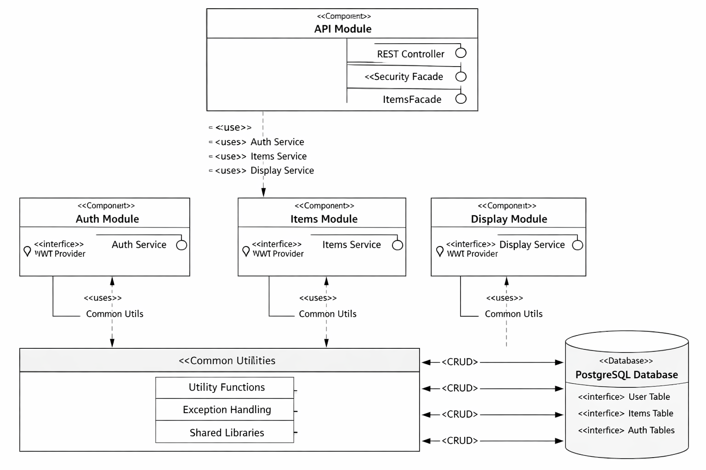

# Financial Planner: Forecast Ledger — API NET

[](https://github.com/rdonalson/FPFL-Angular-NET/actions/workflows/build-push-api-net.yml)
[](https://dotnet.microsoft.com/)
[](https://learn.microsoft.com/aspnet/core)
[](../LICENSE)

A clean, enterprise‑grade, modular .NET platform built with **.NET 10**, **ASP.NET Core**, and **Entity Framework Core**. The solution follows Domain‑Driven Design and is organized into bounded‑context projects that mirror the Maven modules of the sister [API‑JDK](https://github.com/rdonalson/FPFL-React-Java/tree/main/API-JDK), for clarity, testability, and long‑term maintainability.

It replaces the original version's .NET Core 3.1 layered API, bringing over API‑JDK's response envelope, centralized error handling, sanitizers, and JWT auth with refresh‑token rotation.

> 🚧 **Work in progress.** API‑NET is being built up to full feature parity with API‑JDK. See [Project Status](#-project-status).

---

## Overview

**Purpose**
Provide a modular backend API that stores, manages, and projects user financial planning items (recurring payments, incomes, and scheduled events). **Fpfl.Api** exposes the REST endpoints and is the single runnable entrypoint; authentication, domain logic, projections, and persistence live in separate bounded‑context projects.

**Key technologies**
.NET 10 · ASP.NET Core (controllers) · Entity Framework Core 10 + Npgsql · JWT bearer (`Microsoft.IdentityModel.JsonWebTokens`) · BCrypt.Net‑Next · `Microsoft.AspNetCore.OpenApi` + Swagger UI · ASP.NET Core rate limiting & health checks · xUnit · PostgreSQL

**Deployed as**
A multi‑stage Docker image (`fpflapinetimg`) pushed to Azure Container Registry and rolled out to AKS by GitHub Actions. Live at <https://api-net.ledger-finance.com> · Swagger UI at <https://api-net.ledger-finance.com/swagger-ui>.

---

## Quick links

- **Runnable project**: `src/Fpfl.Api/` (ASP.NET Core app, the only executable)
- **Request samples**: [`src/Fpfl.Api/Fpfl.Api.http`](src/Fpfl.Api/Fpfl.Api.http) — runnable from Visual Studio / VS Code
- **Docs**: [`docs/`](docs) — module architecture and ER diagrams
- **CI/CD workflow**: [`../.github/workflows/build-push-api-net.yml`](../.github/workflows/build-push-api-net.yml)
- **Kubernetes manifests**: [`../k8s/api-net`](../k8s/api-net)
- **License**: [`../LICENSE`](../LICENSE) (MIT)

---

## Project structure

Each bounded context is a class‑library project referenced by `Fpfl.Api`, all in one solution ([`Fpfl.slnx`](Fpfl.slnx)).

```
API-NET/
 ├── src/
 │    ├── Fpfl.Api/        # REST API, controllers, DTOs, mappers, envelope, error handling, app bootstrap
 │    ├── Fpfl.Auth/       # Authentication and authorization domain
 │    ├── Fpfl.Items/      # Domain + persistence for item types, time periods (items next)
 │    ├── Fpfl.Display/    # Ledger readout and recurrence expansion (being ported)
 │    └── Fpfl.Common/     # Shared exceptions and sanitization
 ├── tests/
 │    └── Fpfl.Api.Tests/  # xUnit tests
 ├── docs/                 # Architecture and ER diagrams
 ├── Dockerfile            # Multi-stage build (SDK 10 → ASP.NET 10 runtime)
 ├── docker-compose.yml    # Local container run
 └── Fpfl.slnx             # Solution
```

Inside each bounded context the folders follow the same layering: `Domain/` (entities, repository and service interfaces) → `Application/` (services) → `Infrastructure/` (EF Core `DbContext`, configurations, repositories, health checks), plus a `DependencyInjection.cs` that registers the context with one call (`AddFpflItems`, `AddFpflAuth`, `AddFpflCommon`).

---

## Module responsibilities

### **Fpfl.Api** (mirrors `module-api`)

- Exposes REST endpoints and the OpenAPI document (`/openapi/v1.json`), browsable in Swagger UI at `/swagger-ui`
- Defines DTOs (records with validation attributes), explicit mappers, and the `ApiResponse<T>` envelope
- `ApiResponseFactory` runs every outgoing payload through the sanitizer
- `GlobalExceptionHandler` (`IExceptionHandler`) maps domain exceptions to HTTP statuses, logs with a **correlation ID**, and returns a generic message for 500s
- `InvalidModelStateResponseFactory` returns validation failures in the same envelope; `AuthEnvelopeEvents` does the same for JWT 401/403s
- Owns the composition root: CORS, authentication/authorization, rate limiting, health checks, static landing page

**Controllers:** `AuthController`, `UserRolesController`, `ItemTypesController`, `TimePeriodsController`, `ClientLogsController`

### **Fpfl.Auth** (mirrors `module-auth`)

- Users, roles, user‑role assignments, and persisted refresh tokens (`AuthDbContext`)
- `AuthService` — login, guest login, register, refresh (rotation), logout, change password
- `UserRolesService` — admin role management, with a guard that stops an admin removing their own admin role
- `JwtTokenService` — HS256 access tokens, random refresh tokens stored as SHA‑256 hashes
- `BCryptPasswordHasher` — work factor 10, verifies the Spring `$2a$` hashes already in the shared database
- `AuthOptions` (`Auth` config section) — issuer, audience, signing key (≥ 32 chars, fail‑fast at startup), token lifetimes, guest account
- Registers JWT bearer authentication with `MapInboundClaims = false` so claim names stay as issued (`sub`, `id`, `user_id`, `role`, `guest`)

### **Fpfl.Items** (mirrors `module-items-bc`)

- Owns the domain model and invariants for `ItemType` and `TimePeriod` (`Item` next)
- Ports‑and‑adapters split: domain `I*Repository` / `I*Service` interfaces, application services, EF Core repositories
- Repositories translate PostgreSQL errors into domain exceptions — unique violations → `DuplicateItemException` (409), foreign‑key violations → `DomainValidationException` (400), anything else → `RepositoryException` (500)
- Supports changing a reference row's **id** as well as its name, refusing the change while items still use it
- `ItemsDatabaseHealthCheck` backs the `db` entry in `/health`

### **Fpfl.Display** (mirrors `module-display-bc`)

- Will expand each item's recurrence metadata into dated occurrences — one expander per pattern (one‑time, daily, weekly, bi‑weekly, monthly, bi‑monthly, quarterly, semi‑annual, annual, nth‑weekday) — and compose them with the user's initial amount into a running‑balance ledger
- Replaces the original version's database stored procedure with testable application code; currently an empty project referencing `Fpfl.Items` and `Fpfl.Common`

### **Fpfl.Common** (mirrors `module-common-bc`)

- Shared exceptions: the abstract `DomainException` base, plus `DomainValidationException` (400), `SanitizationException` (400), `InvalidCredentialsException` (401), `ForbiddenOperationException` (403), `ItemNotFoundException` (404), `DuplicateItemException` (409), `RepositoryException` (500)
- `Sanitizer` — port of API‑JDK's `SanitizerImpl`: walks object graphs and normalizes every string (BOM, zero‑width, and control characters stripped; whitespace collapsed), then enforces **strict** text (letters, digits, space, `-_'.`) by default, **lenient** text with `[LenientText]`, or a URI character set; `INoSanitize` opts a type out
- Use sparingly — only for true cross‑cutting concerns

---

## Dependency rules

- No cross‑context leakage: domain logic stays in its owning bounded context.
- No circular dependencies.
- `Fpfl.Api` is the only runnable project and the only one that knows about HTTP contracts (DTOs, envelope).
- Each bounded context owns its own `DbContext` mapped onto the shared schema.
- Actual dependency edges:

```
Fpfl.Api  ──► Fpfl.Auth ──► Fpfl.Common
    │                          ▲
    ├──────► Fpfl.Display ─────┤
    │              │           │
    │              ▼           │
    └──────► Fpfl.Items ───────┘
```

---

## 🧭 Architecture Overview

The module layout is the same as API‑JDK's — an API layer delegating to Auth, Items, and Display contexts over shared common utilities and one PostgreSQL database:



---

## 🌐 Endpoints

Routes and response messages match API‑JDK. Every response uses the envelope:

```json
{ "status": 200, "message": "ItemTypes fetched successfully", "data": [ ... ], "correlationId": "", "timestamp": "2026-10-17T16:00:00Z" }
```

Errors carry `"data": null` and a `correlationId` that matches the server log entry.

| Method & route | Access | Purpose |
| -------------- | ------ | ------- |
| `POST /auth/login` | Public | Sign in with email + password |
| `POST /auth/guest` | Public | Sign in as the shared guest account (no password sent) |
| `POST /auth/register` | Public | Create an account (`ROLE_USER`) and sign it in |
| `POST /auth/refresh` | Public | Exchange a refresh token for a new session (single‑use) |
| `POST /auth/logout` | Public | Revoke a refresh token |
| `POST /auth/change-password` | Signed in (not guest) | Change password; signs out other devices |
| `GET /auth/me` | Signed in | Who the access token belongs to |
| `GET /item-types` · `GET /item-types/{id}` | Public | List / get item types |
| `POST /item-types` · `PUT /item-types/{id}` · `DELETE /item-types/{id}` | **Admin** | Create / rename or change id / delete |
| `GET /time-periods` · `GET /time-periods/{id}` | Public | List / get time periods |
| `POST /time-periods` · `PUT /time-periods/{id}` · `DELETE /time-periods/{id}` | **Admin** | Create / rename or change id / delete |
| `GET /users/{userId}/roles` | **Admin** | A user's role names |
| `POST /users/{userId}/roles/{roleId}` · `DELETE …/{roleId}` | **Admin** | Add / remove one role |
| `PUT /users/{userId}/roles` | **Admin** | Replace all roles (`{ "roleIds": [...] }`) |
| `POST /client-logs` | Public, rate‑limited | Write a UI log entry to the server log |
| `GET /health` | Public | Health with database check (Actuator‑style JSON) |

`PUT /item-types/{id}` and `PUT /time-periods/{id}` accept an optional `id` in the body: omit it to rename (as API‑JDK does), or send a different value to change the id.

---

# 🗄️ PostgreSQL Database Structure

API‑NET connects to the **same PostgreSQL database and `fpfl` schema as API‑JDK**. The schema is owned by API‑JDK (Hibernate `ddl-auto: update`), so EF Core maps onto the existing tables and is **never** used to generate migrations against it.

---

## **📌 Tables Overview**

### **items** *(mapped when the Items port lands)*

Stores all user‑defined financial items, including scheduling metadata. The recurrence columns are mutually exclusive — only the set matching the item's `fk_time_period` is populated, and the ledger reads exactly that set when expanding occurrences.

| **Column** | **Description** |
| ---------- | --------------- |
| **id** | Primary key |
| **user_id** | Owner of the item (UUID referencing `users.user_id`) |
| **name** / **amount** | Item name and monetary value |
| **fk_item_type** | Foreign key → `item_types.id` |
| **fk_time_period** | Foreign key → `time_periods.id` |
| **begin_date** / **end_date** | Date bounds |
| **weekly_dow** / **every_other_week_dow** | Weekly and bi‑weekly day of week |
| **bi_monthly_day_1** / **bi_monthly_day_2** | Bi‑monthly days |
| **monthly_dom** | Monthly day of month |
| **quarterly_1..4_month** / **quarterly_1..4_day** | Quarterly dates |
| **semi_annual_1..2_month** / **semi_annual_1..2_day** | Semi‑annual dates |
| **annual_moy** / **annual_dom** | Annual month and day |
| **nth_dow** / **nth_index** | Nth‑weekday pattern |
| **date_range_req** | Whether a date range is required |

---

### **item_types**

The credit / debit / initial‑amount classification applied to the ledger. Mapped by `ItemTypeConfiguration`; the id is supplied by the caller (not generated).

| **Column** | **Description** |
| ---------- | --------------- |
| **id** | Primary key |
| **name** | Type name |

---

### **time_periods**

The recurrence period for an item; the chosen period determines which recurrence columns on `items` are used. Mapped by `TimePeriodConfiguration`; the id is supplied by the caller because the recurrence expanders are keyed by it.

| **Column** | **Description** |
| ---------- | --------------- |
| **id** | Primary key |
| **name** | Period name (one‑time, daily, weekly, monthly, quarterly, annual, …) |

---

### **users**

Application accounts used by `Fpfl.Auth` and referenced by items.

| **Column** | **Description** |
| ---------- | --------------- |
| **id** | Primary key (identity) used for relational joins |
| **user_id** | Application UUID for the user (used as `items.user_id`) |
| **email** | Unique sign‑in name (matched case‑insensitively) |
| **password_hash** | BCrypt hash |
| **first** / **last** | First and last name |
| **created_at** | Account creation timestamp |

---

### **roles** · **user_roles**

| **Table** | **Columns** |
| --------- | ----------- |
| **roles** | `id` (identity), `name` (`ROLE_USER`, `ROLE_ADMIN`) |
| **user_roles** | `user_id` → `users.id`, `role_id` → `roles.id` (composite key) |

---

### **refresh_tokens**

| **Column** | **Description** |
| ---------- | --------------- |
| **id** | Primary key (identity) |
| **token** | **SHA‑256 hash** of the refresh token — the raw token is never stored |
| **user_id** | FK → `users.id` |
| **expiry_date** | Expiration timestamp |

---

## **🔗 Relationships**

- `items.fk_item_type` → `item_types.id` · `items.fk_time_period` → `time_periods.id` · `items.user_id` → `users.user_id`
- `user_roles.user_id` → `users.id` · `user_roles.role_id` → `roles.id`
- `refresh_tokens.user_id` → `users.id`

---

## **🧩 ER Diagram**


---

## ⚙️ Configuration

Non‑secret defaults live in [`appsettings.json`](src/Fpfl.Api/appsettings.json). Secrets come from **user‑secrets** in development and **environment variables** (a Kubernetes secret) in production — never from committed files.

| Key | Default | Purpose |
| --- | ------- | ------- |
| `ConnectionStrings:Fpfl` | *(secret — required)* | Npgsql connection string; startup fails fast if missing |
| `Auth:SigningKey` | *(secret — required, ≥ 32 chars)* | HS256 JWT signing key; startup fails fast if missing or short |
| `Auth:Issuer` / `Auth:Audience` | `fpfl-api-net` / `fpfl-ui-ng` | Token issuer and audience |
| `Auth:AccessTokenMinutes` | `15` | Access token lifetime |
| `Auth:RefreshTokenDays` | `7` | Refresh token lifetime |
| `Auth:GuestEmail` | `guest.user@gmail.com` | Account used by `POST /auth/guest` |
| `Cors:AllowedOrigins` | `["http://localhost:4200"]` | Browser origins allowed to call the API |

Environment variables use double underscores, e.g. `ConnectionStrings__Fpfl`, `Auth__SigningKey`, `Cors__AllowedOrigins__0`.

HTTPS redirection is enabled outside Development only — browsers won't follow a redirect on a CORS preflight, and in production TLS terminates at the ingress (forwarded headers are honored).

---

## Build the entire solution

From the `API-NET` directory:

```bash
dotnet build
```

---

## Run the API

Set the secrets once:

```bash
dotnet user-secrets set "ConnectionStrings:Fpfl" "Host=localhost;Port=5432;Database=FPFL-V2;Username=postgres;Password=..." --project src/Fpfl.Api
dotnet user-secrets set "Auth:SigningKey" "<at least 32 random characters>" --project src/Fpfl.Api
```

Then run:

```bash
dotnet run --project src/Fpfl.Api
```

Or press **F5** in Visual Studio with the `http` profile.

| Endpoint | URL |
| -------- | --- |
| Welcome page | <http://localhost:5132/> |
| Swagger UI | <http://localhost:5132/swagger-ui> |
| OpenAPI document | <http://localhost:5132/openapi/v1.json> |
| Health | <http://localhost:5132/health> |

---

## 🐳 Docker

The [`Dockerfile`](Dockerfile) is a two‑stage build: `mcr.microsoft.com/dotnet/sdk:10.0` copies the project files first so `dotnet restore` caches cleanly, then publishes `Fpfl.Api`; `mcr.microsoft.com/dotnet/aspnet:10.0` runs it as a **non‑root** user on port **8080** with forwarded headers enabled.

```bash
# copy the values into .env.docker first (connection string, signing key, CORS origins)
docker compose up --build
```

`docker-compose.yml` reads `.env.docker` (Git‑ignored) and maps `5132:8080`; PostgreSQL on the host is reached through `host.docker.internal`.

---

## 🔄 CI/CD

Pushes to `master` that touch `API-NET/**` or `k8s/api-net/**` trigger [`build-push-api-net.yml`](../.github/workflows/build-push-api-net.yml):

1. Run `dotnet test` — a failing test stops the pipeline
2. Build and push `fpflacr.azurecr.io/fpflapinetimg` tagged `:${{ github.sha }}` and `:latest`, with GitHub Actions layer caching
3. Azure login → set AKS context (`fpfl-cluster`) → confirm `api-net-secret` exists → `kubectl apply` the service, deployment, and ingress
4. `kubectl rollout restart deployment/api-net -n fpfl` and wait for `rollout status`

In the cluster the pod runs on the dedicated `netpool` node pool; readiness uses `/health` (database included) and liveness uses `/` so a database outage doesn't restart the pod. Full pipeline details are in the [root README](../README.md#-cicd-pipeline).

---

## 🧪 Running Tests

```bash
dotnet test
```

[`Fpfl.Api.Tests`](tests/Fpfl.Api.Tests) uses **xUnit** with hand‑written in‑memory fakes and a fixed `TimeProvider`, so the suite runs without a database:

- [`AuthServiceTests`](tests/Fpfl.Api.Tests/AuthServiceTests.cs) — login, guest, refresh rotation, expiry, logout, change password, token claims, Spring‑style BCrypt hashes
- [`UserRolesServiceTests`](tests/Fpfl.Api.Tests/UserRolesServiceTests.cs) — add / remove / replace roles, self‑lockout guard
- [`ItemTypeServiceTests`](tests/Fpfl.Api.Tests/ItemTypeServiceTests.cs) · [`TimePeriodServiceTests`](tests/Fpfl.Api.Tests/TimePeriodServiceTests.cs) — validation, duplicates, rename and id changes, delete
- [`SanitizerTests`](tests/Fpfl.Api.Tests/SanitizerTests.cs) — strict / lenient / URI rules, nested objects, opt‑outs

---

## 🚧 Project Status

The goal is the same feature set as [API‑JDK](https://github.com/rdonalson/FPFL-React-Java/tree/main/API-JDK).

| Area | Status |
| ---- | ------ |
| Response envelope, global exception handling, sanitizer | ✅ Done |
| Auth — login, guest, register, refresh, logout, change password, me | ✅ Done |
| User roles (admin) | ✅ Done |
| Client logs | ✅ Done |
| Item types — CRUD with id changes | ✅ Done |
| Time periods — CRUD with id changes | ✅ Done |
| Health checks, Swagger UI, landing page | ✅ Done |
| Docker image, AKS deployment, CI/CD with tests | ✅ Done |
| Items (credits / debits with recurrence) | 🔜 Planned |
| Initial amount | 🔜 Planned |
| Ledger readout + recurrence expanders (`Fpfl.Display`) | 🔜 Planned |

---

## 🧰 Development Notes

- Keep domain logic inside the bounded context that owns it
- Controllers stay thin — they delegate to services and map through DTOs; errors are thrown as domain exceptions and handled globally, never caught in controllers
- Use `Fpfl.Common` sparingly — only for true cross‑cutting concerns
- Sanitize user‑supplied strings through the sanitizer (`[StrictText]` / `[LenientText]` / `INoSanitize`) rather than ad‑hoc cleanup
- Take the user id from the access token's claims, never from the request body
- Don't add EF Core migrations — the schema is shared with API‑JDK
- Never commit `appsettings.*.json` secrets, `.env.docker`, or a real signing key
- If Visual Studio breaks on domain exceptions while debugging, they are expected — the global handler turns them into 4xx responses (adjust Exception Settings or continue)

---

## 📄 License

This project is licensed under the [MIT License](../LICENSE).
