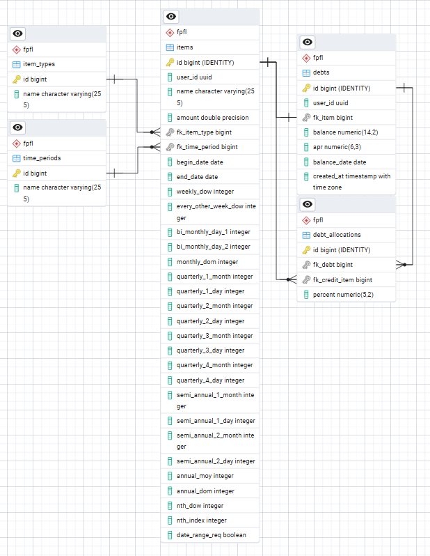
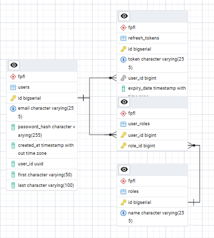

# **FPFL‑Angular‑NET — Financial Planner / Forecasted Ledger**

A full‑stack financial planning system built with an **Angular 22 / TypeScript UI**, a **.NET 10 / ASP.NET Core API**, and a **PostgreSQL** database — containerized with Docker, deployed to **Azure Kubernetes Service** through **GitHub Actions**.

This is a ground‑up rebuild of the original [Angular/.NET Core version](https://github.com/rdonalson/Financial-Planner-Forecast-Ledger) written nine years ago, carrying over the architecture developed for the newer [React/Java version](https://github.com/rdonalson/FPFL-React-Java): bounded‑context modules, a standard response envelope, centralized error handling, input sanitization, and JWT auth with refresh‑token rotation.

The project is organized into two top‑level applications plus shared infrastructure:

- **[UI-NG](./UI-NG/README.md)** → Angular 22 front‑end (standalone, zoneless, signals)
- **[API-NET](./API-NET/README.md)** → Modular .NET 10 API (bounded‑context projects)
- **[k8s](./k8s)** → Kubernetes manifests and one‑time cluster setup script
- **[.github/workflows](./.github/workflows)** → CI/CD pipelines

This repository serves as the **parent project**, containing both applications, the deployment manifests, and their shared development workflow.

> 🚧 **Nearly at parity, and past it.** Auth, credits and debits with every recurrence pattern, the initial amount, the forecasted ledger with its chart and **Excel export**, item types, time periods, and the full deployment pipeline are live. **Debt Paydown**, a feature neither earlier version had, tracks how credit card and other debts get paid down. Only the admin status page remains to match FPFL-React-Java. See [Project Status](#-project-status).

### 🌐 Live Environment

| Surface | URL |
| ------- | --- |
| UI | <https://ui-ng.ledger-finance.com> (guest login available) |
| API | <https://api-net.ledger-finance.com> |
| API docs | <https://api-net.ledger-finance.com/swagger-ui> |

---

## **📁 Repository Structure**

```
FPFL-Angular-NET/
 ├── .github/
 │    └── workflows/
 │         ├── build-push-api-net.yml   # CI/CD: API-NET → ACR → AKS (tests first)
 │         └── build-push-ui-ng.yml     # CI/CD: UI-NG   → ACR → AKS
 ├── UI-NG/            # Angular 22 front-end application
 ├── API-NET/          # .NET 10 backend (modular solution)
 ├── k8s/
 │    ├── api-net/     # api-net-deployment / -service / -ingress
 │    ├── ui-ng/       # ui-ng-deployment / -service / -ingress
 │    └── setup-fpfl-net.sh   # one-time: node pool, secrets, DNS
 ├── docker-compose.yml       # run UI + API together locally
 ├── LICENSE
 └── README.md         # (this file)
```

### 🔗 Direct Links

- **Angular UI** → [UI-NG](./UI-NG)
- **.NET API** → [API-NET](./API-NET)
- **Kubernetes manifests** → [k8s](./k8s)

Each subproject contains its own dedicated README with deeper details.

---

# **🧭 System Overview**

The FPFL system is designed as a **modular, maintainable, enterprise‑grade full‑stack application**:

### **Frontend (UI‑NG)**

- **Angular 22** + **TypeScript 6** — standalone components only (no NgModules), **zoneless** change detection, `OnPush` everywhere
- **Signals** for state and **`httpResource`** for data loading, replacing the original version's NgRx store/effects/reducers
- **PrimeNG 22** components with the **Aura** theme (`@primeuix/themes`) and PrimeIcons
- Functional **HTTP interceptors** (loading, error normalization, auth + silent refresh) and functional **route guards**
- JWT session handling with refresh‑token rotation, one‑click **guest login**, and a session‑expiring warning dialog
- **Vitest** unit tests through Angular's `@angular/build:unit-test` runner
- **Chart.js** (through PrimeNG's chart) for the forecast and **ExcelJS** for the ledger download, loaded only when used
- Organized as `core/` (api, auth, http, layout, system) and lazy‑loaded `features/`

### **Backend (API‑NET)**

- Built with **.NET 10**, **ASP.NET Core** controllers, and **Entity Framework Core** (Npgsql)
- Organized into projects that mirror the Java API's Maven modules:

| Project | Mirrors (API‑JDK) | Role |
| ------- | ----------------- | ---- |
| `Fpfl.Api` | `module-api` | REST controllers, DTOs, mappers, response envelope, global exception handling, OpenAPI, health |
| `Fpfl.Items` | `module-items-bc` | Domain logic & persistence for items (credits / debits), the initial amount, item types and time periods |
| `Fpfl.Display` | `module-display-bc` | Forecast ledger: recurrence expanders and the running‑balance ledger builder |
| `Fpfl.Auth` | `module-auth` | Users, roles, JWT issue/validation, refresh tokens, BCrypt hashing |
| `Fpfl.Common` | `module-common-bc` | Domain exceptions and the sanitizer |

- Connects to **PostgreSQL** (schema `fpfl`) — the **same database** as API‑JDK
- OpenAPI document served by `Microsoft.AspNetCore.OpenApi`, browsable in **Swagger UI**
- Health exposed at `/health` (Actuator‑style JSON) and wired into Kubernetes probes

For full backend details, see the API README:
👉 [API-NET/README.md](./API-NET/README.md)

---

# **🔐 Authentication & Security**

- **JWT bearer** authentication (HS256) — short‑lived access tokens (15 min) plus **single‑use refresh tokens** (7 days) stored only as **SHA‑256 hashes** and rotated on every refresh
- **Guest login** handled server‑side — the browser never sees the guest password
- Passwords hashed with **BCrypt** (work factor 10), compatible with the Spring `$2a$` hashes already in the shared database
- **Role‑based access** — `ROLE_ADMIN` / `ROLE_USER` drive both API authorization (`[Authorize(Roles = …)]`) and UI admin actions
- 401/403 responses use the same response envelope as every other error
- **Rate limiting** on anonymous write endpoints (`/client-logs`), request size limits, and log‑forging protection
- Secrets (connection string, signing key) come from **user‑secrets** in development and **Kubernetes secrets** in production — never from committed files

---

# **🗄️ Database Overview (PostgreSQL)**

API‑NET reads and writes the **same `fpfl` schema** as API‑JDK, so both stacks share users, items, and reference data. The schema is owned by API‑JDK (Hibernate `ddl-auto=update`); EF Core maps onto the existing tables and is **not** used to generate migrations.

### **Domain Entities**

- `Item` — user‑defined financial items with amount, date bounds, and recurrence metadata
- `Debt` / `DebtAllocation` — Debt Paydown's tracked debts and the credits allocated to them (API‑NET only; created by `API-NET/db/001_debt_paydown.sql`)
- `ItemType` — credit / debit / initial‑amount classification
- `TimePeriod` — recurrence periods (one‑time, daily, weekly, bi‑weekly, monthly, quarterly, annual, etc.)

### **Auth Entities**

- `User` — application accounts
- `Role` / `UserRole` — role assignments (composite key)
- `RefreshToken` — persisted (hashed) refresh tokens for session renewal

**Items** — items, item types, time periods, and Debt Paydown's debts and allocations:



**Auth** — users, roles, and refresh tokens:



A full table breakdown is included in the API README.

---

# **📈 Forecasted Ledger Engine**

The original version computed the ledger in a database stored procedure. This rebuild moves it into the `Fpfl.Display` project as a **pure, unit‑tested business‑layer engine**, ported from API‑JDK's recurrence expanders — one expander per time period:

| Expander | Pattern |
| -------- | ------- |
| One‑time | Once, on the begin date |
| Daily | Every day in range |
| Weekly | Weekly on a chosen weekday |
| Every two weeks | Every other week, anchored on the begin date |
| Bi‑monthly | Two days per month (e.g. the 15th and the last day) |
| Monthly | Monthly on a chosen day (the 31st becomes each month's last day) |
| Quarterly | Four month/day pairs a year |
| Semi‑annual | Two month/day pairs a year |
| Annual | Yearly (Feb 29 falls on Feb 28 outside leap years) |
| Nth weekday | 1st–4th or last weekday of the month (e.g. the 2nd Tuesday) |

`LedgerBuilder` turns the user's items into one row per day — credits, debits, net, and a running balance that starts from the **initial amount** — with each day's items nested inside. An item's own date range narrows when it can occur. `POST /display/ledger` returns that ledger; the UI shows it as summary tiles, a balance chart, a credits‑and‑debits chart, and an expandable ledger table, and downloads it as an Excel workbook.

### Improvements over the Java engine

- **Sunday works** — weekdays are stored as 0 = Sunday, which Java's `DayOfWeek.of()` rejected; .NET's `DayOfWeek` uses the same numbering
- **Every‑two‑weeks dates stay put** — counted from the item's begin date instead of the ledger's start date, so paydays don't shift with the chosen range
- **Exact cents** — sums use `decimal`, so long runs don't drift (`0.1 + 0.2` stays `0.30`)
- **Owner‑only** — a user can only build their own ledger (Java trusted the `userId` in the body), and a request is capped at 10 years

---

# **💳 Debt Paydown**

A feature new to this version. Pick a debit you're paying down (a credit card payment, say), enter what's owed and an optional APR, then send a percentage of any credits to it — "30% of every paycheck, 50% of every bonus".

- **Engine** — `PaydownCalculator` in `Fpfl.Display` reuses the recurrence expanders. Starting from the balance on the day it was entered, each occurrence of the debit's own payment and of every allocated credit reduces what's owed; interest (APR ÷ 12) is added at each month end; payments stop at $0 with the last one cut to what's left; and it projects up to 30 years out to find the payoff date. Pure and unit‑tested like the ledger builder.
- **Main forecast** — allocations appear in the ledger as extra **"Debt Paydown"** debits, so the running balance stays truthful (the debit's own payment is already a debit and isn't counted twice).
- **Rules** — only your own debits and credits; a debit is tracked once; and no credit can be allocated more than 100% across all your debts (*"Paycheck is already 70% allocated to other debts; at most 30% is left"*).
- **UI** — a **Debt Paydown** setup page (cards per debt, an editor with live dollars‑per‑occurrence and "% left" hints), plus **Paydown chart** and **Paydown ledger** tabs on Display and a **Debt Paydown** sheet in the Excel export with the same expandable rows.
- **Storage** — two new tables, `fpfl.debts` and `fpfl.debt_allocations`, created by [`API-NET/db/001_debt_paydown.sql`](API-NET/db/001_debt_paydown.sql) (the shared schema is owned by API‑JDK, so new tables come from scripts, not EF migrations).

---

# **🚧 Project Status**

Ultimately this version will match every feature of [FPFL-React-Java](https://github.com/rdonalson/FPFL-React-Java).

| Area | UI‑NG | API‑NET |
| ---- | ----- | ------- |
| Auth — login, guest, register, refresh, logout, change password | ✅ | ✅ |
| User roles (admin) | — | ✅ |
| Client error logging (`/client-logs`) | 🔜 | ✅ |
| Item types — CRUD | ✅ | ✅ |
| Time periods — CRUD | ✅ | ✅ |
| Sidebar menu with role‑filtered admin section | ✅ | — |
| Items — credits / debits with recurrence | ✅ | ✅ |
| Initial amount (created automatically) | ✅ | ✅ |
| Forecasted ledger + chart | ✅ | ✅ |
| Ledger download to Excel (expandable rows) | ✅ | — |
| **Debt Paydown** — tracked debts, allocations, paydown chart / ledger / Excel sheet *(new)* | ✅ | ✅ |
| Admin status page | 🔜 | ✅ (`/health`) |
| Docker, AKS, GitHub Actions CI/CD | ✅ | ✅ |

---

# **🕰️ Project Lineage**

| Version | Stack | Repository |
| ------- | ----- | ---------- |
| Original | Angular / .NET Core 3.1, NgRx, Azure AD sign‑in, stored‑procedure ledger | [Financial-Planner-Forecast-Ledger](https://github.com/rdonalson/Financial-Planner-Forecast-Ledger) |
| Sister project | React 19 / Java 25 + Spring Boot 4 on AKS | [FPFL-React-Java](https://github.com/rdonalson/FPFL-React-Java) |
| **This repo** | **Angular 22 / .NET 10 on AKS** | FPFL-Angular-NET |

`ASP.NET MVC → Angular/.NET Core → React/Spring Boot on AKS → Angular 22/.NET 10 on AKS`

---

# 🗂️ Portfolio Samples

A guided tour of the codebase. All links are relative to the repository root.

## Infrastructure

- [.github/workflows/build-push-api-net.yml](.github/workflows/build-push-api-net.yml)
- [.github/workflows/build-push-ui-ng.yml](.github/workflows/build-push-ui-ng.yml)
- [k8s/api-net/api-net-deployment.yaml](k8s/api-net/api-net-deployment.yaml) · [api-net-service.yaml](k8s/api-net/api-net-service.yaml) · [api-net-ingress.yaml](k8s/api-net/api-net-ingress.yaml)
- [k8s/ui-ng/ui-ng-deployment.yaml](k8s/ui-ng/ui-ng-deployment.yaml) · [ui-ng-service.yaml](k8s/ui-ng/ui-ng-service.yaml) · [ui-ng-ingress.yaml](k8s/ui-ng/ui-ng-ingress.yaml)
- [k8s/setup-fpfl-net.sh](k8s/setup-fpfl-net.sh) — node pool, secrets, DNS
- [docker-compose.yml](docker-compose.yml)

---

## Front End — Angular 22 / TypeScript

- [UI-NG](UI-NG) · [package.json](UI-NG/package.json) · [angular.json](UI-NG/angular.json) · [Dockerfile](UI-NG/Dockerfile) · [nginx.conf](UI-NG/nginx.conf)

### App Shell, Config & Routing

- [main.ts](UI-NG/src/main.ts)
- [app.config.ts](UI-NG/src/app/app.config.ts) — providers, interceptors, PrimeNG theme, app initializer
- [app.routes.ts](UI-NG/src/app/app.routes.ts) — lazy `loadComponent` routes
- [app.ts](UI-NG/src/app/app.ts) · [app.html](UI-NG/src/app/app.html)
- [Topbar](UI-NG/src/app/core/layout/topbar/topbar.ts) · [Sidebar](UI-NG/src/app/core/layout/sidebar/sidebar.ts) · [menu.ts](UI-NG/src/app/core/layout/sidebar/menu.ts) · [Footer](UI-NG/src/app/core/layout/footer/footer.ts)

### Authentication & Session

- [AuthService](UI-NG/src/app/core/auth/auth.ts) — signals‑based session, refresh, restore
- [AuthUi](UI-NG/src/app/core/auth/auth-ui.ts) · [auth.models.ts](UI-NG/src/app/core/auth/auth.models.ts)
- [authGuard](UI-NG/src/app/core/auth/auth-guard.ts) · [adminGuard](UI-NG/src/app/core/auth/admin-guard.ts)
- [LoginDialog](UI-NG/src/app/core/auth/ui/login-dialog/login-dialog.ts) · [RegisterDialog](UI-NG/src/app/core/auth/ui/register-dialog/register-dialog.ts) · [ChangePasswordDialog](UI-NG/src/app/core/auth/ui/change-password-dialog/change-password-dialog.ts) · [SessionExpiringDialog](UI-NG/src/app/core/auth/ui/session-expiring-dialog/session-expiring-dialog.ts)

### HTTP Layer

- [api-response.ts](UI-NG/src/app/core/api/api-response.ts) — `ApiResponse<T>` envelope and `ApiError`
- [auth-interceptor.ts](UI-NG/src/app/core/http/auth-interceptor.ts) — bearer token, 401 → refresh → retry
- [error-interceptor.ts](UI-NG/src/app/core/http/error-interceptor.ts) — normalizes every failure to `ApiError`
- [loading-interceptor.ts](UI-NG/src/app/core/http/loading-interceptor.ts) · [loading.ts](UI-NG/src/app/core/http/loading.ts)

### Features

- [Home](UI-NG/src/app/features/home/home.ts) — PrimeNG Galleria landing page
- [ItemTypes](UI-NG/src/app/features/item-types/item-types.ts) · [item-types-api.ts](UI-NG/src/app/features/item-types/data-access/item-types-api.ts)
- [TimePeriods](UI-NG/src/app/features/time-periods/time-periods.ts) · [time-periods-api.ts](UI-NG/src/app/features/time-periods/data-access/time-periods-api.ts)
- **Credits & debits** — [ItemList](UI-NG/src/app/features/item-detail/item-list/item-list.ts) · [PeriodPicker](UI-NG/src/app/features/item-detail/period-picker/period-picker.ts) · [ItemEdit](UI-NG/src/app/features/item-detail/item-edit/item-edit.ts) · [item-form.ts](UI-NG/src/app/features/item-detail/item-form.ts) · [schedule.ts](UI-NG/src/app/features/item-detail/schedule.ts) · [item-api.ts](UI-NG/src/app/features/item-detail/data-access/item-api.ts)
- **Initial amount** — [InitialAmountPage](UI-NG/src/app/features/item-detail/initial-amount/initial-amount.ts) · [initial-amount-api.ts](UI-NG/src/app/features/item-detail/data-access/initial-amount-api.ts)
- **Debt Paydown** — [DebtPaydownPage](UI-NG/src/app/features/debt-paydown/debt-paydown.ts) · [debt-paydown.models.ts](UI-NG/src/app/features/debt-paydown/debt-paydown.models.ts) · [debt-api.ts](UI-NG/src/app/features/debt-paydown/data-access/debt-api.ts) · [PaydownChart](UI-NG/src/app/features/display/paydown/paydown-chart.ts) · [PaydownLedger](UI-NG/src/app/features/display/paydown/paydown-ledger.ts) · [paydown.models.ts](UI-NG/src/app/features/display/paydown/paydown.models.ts)
- **Display (forecast)** — [DisplayPage](UI-NG/src/app/features/display/display.ts) · [display.models.ts](UI-NG/src/app/features/display/display.models.ts) · [LedgerChart](UI-NG/src/app/features/display/chart/chart.ts) · [chart-data.ts](UI-NG/src/app/features/display/chart/chart-data.ts) · [Ledger](UI-NG/src/app/features/display/ledger/ledger.ts) · [ledger-export.ts](UI-NG/src/app/features/display/export/ledger-export.ts) · [display-api.ts](UI-NG/src/app/features/display/data-access/display-api.ts)

### Testing

- [test-providers.ts](UI-NG/src/testing/test-providers.ts) — shared TestBed providers and envelope helpers
- [auth.spec.ts](UI-NG/src/app/core/auth/auth.spec.ts) · [auth-interceptor.spec.ts](UI-NG/src/app/core/http/auth-interceptor.spec.ts) · [item-types.spec.ts](UI-NG/src/app/features/item-types/item-types.spec.ts) · [time-periods.spec.ts](UI-NG/src/app/features/time-periods/time-periods.spec.ts)
- [item-list.spec.ts](UI-NG/src/app/features/item-detail/item-list/item-list.spec.ts) · [item-edit.spec.ts](UI-NG/src/app/features/item-detail/item-edit/item-edit.spec.ts) · [schedule.spec.ts](UI-NG/src/app/features/item-detail/schedule.spec.ts) · [display.spec.ts](UI-NG/src/app/features/display/display.spec.ts) · [ledger.spec.ts](UI-NG/src/app/features/display/ledger/ledger.spec.ts) · [ledger-export.spec.ts](UI-NG/src/app/features/display/export/ledger-export.spec.ts)

---

## Back End — .NET 10 / ASP.NET Core

- [API-NET/Fpfl.slnx](API-NET/Fpfl.slnx) — solution
- [API-NET/Dockerfile](API-NET/Dockerfile) · [docker-compose.yml](API-NET/docker-compose.yml)

### Fpfl.Api

- [Program.cs](API-NET/src/Fpfl.Api/Program.cs) — composition root and middleware pipeline
- [Fpfl.Api.http](API-NET/src/Fpfl.Api/Fpfl.Api.http) — runnable request samples

#### Controllers

- [AuthController](API-NET/src/Fpfl.Api/Controllers/AuthController.cs)
- [UserRolesController](API-NET/src/Fpfl.Api/Controllers/UserRolesController.cs)
- [ItemsController](API-NET/src/Fpfl.Api/Controllers/ItemsController.cs)
- [DebtsController](API-NET/src/Fpfl.Api/Controllers/DebtsController.cs)
- [InitialAmountController](API-NET/src/Fpfl.Api/Controllers/InitialAmountController.cs)
- [DisplayController](API-NET/src/Fpfl.Api/Controllers/DisplayController.cs)
- [ItemTypesController](API-NET/src/Fpfl.Api/Controllers/ItemTypesController.cs)
- [TimePeriodsController](API-NET/src/Fpfl.Api/Controllers/TimePeriodsController.cs)
- [ClientLogsController](API-NET/src/Fpfl.Api/Controllers/ClientLogsController.cs)

#### DTOs & Mappers

- **Auth** — [AuthRequests](API-NET/src/Fpfl.Api/Dtos/Auth/AuthRequests.cs) · [AuthResponse](API-NET/src/Fpfl.Api/Dtos/Auth/AuthResponse.cs) · [AuthMapper](API-NET/src/Fpfl.Api/Mappers/AuthMapper.cs)
- **Item** — [ItemRequest](API-NET/src/Fpfl.Api/Dtos/Items/ItemRequest.cs) · [ItemResponse](API-NET/src/Fpfl.Api/Dtos/Items/ItemResponse.cs) · [InitialAmountDtos](API-NET/src/Fpfl.Api/Dtos/InitialAmounts/InitialAmountDtos.cs) · [ItemMapper](API-NET/src/Fpfl.Api/Mappers/ItemMapper.cs)
- **Display** — [LedgerDtos](API-NET/src/Fpfl.Api/Dtos/Display/LedgerDtos.cs) · [PaydownDtos](API-NET/src/Fpfl.Api/Dtos/Display/PaydownDtos.cs) · [DisplayMapper](API-NET/src/Fpfl.Api/Mappers/DisplayMapper.cs)
- **Debt** — [DebtDtos](API-NET/src/Fpfl.Api/Dtos/Debts/DebtDtos.cs) · [DebtMapper](API-NET/src/Fpfl.Api/Mappers/DebtMapper.cs)
- **ItemType** — [ItemTypeRequests](API-NET/src/Fpfl.Api/Dtos/ItemTypes/ItemTypeRequests.cs) · [ItemTypeResponse](API-NET/src/Fpfl.Api/Dtos/ItemTypes/ItemTypeResponse.cs) · [ItemTypeMapper](API-NET/src/Fpfl.Api/Mappers/ItemTypeMapper.cs)
- **TimePeriod** — [TimePeriodRequests](API-NET/src/Fpfl.Api/Dtos/TimePeriods/TimePeriodRequests.cs) · [TimePeriodResponse](API-NET/src/Fpfl.Api/Dtos/TimePeriods/TimePeriodResponse.cs) · [TimePeriodMapper](API-NET/src/Fpfl.Api/Mappers/TimePeriodMapper.cs)
- **UserRoles** — [ReplaceUserRolesRequest](API-NET/src/Fpfl.Api/Dtos/UserRoles/ReplaceUserRolesRequest.cs)
- **Logging** — [ClientLogRequest](API-NET/src/Fpfl.Api/Dtos/Logging/ClientLogRequest.cs)

#### Response Envelope, Errors, Security & Health

- [ApiResponse](API-NET/src/Fpfl.Api/Responses/ApiResponse.cs) · [ApiResponseFactory](API-NET/src/Fpfl.Api/Responses/ApiResponseFactory.cs)
- [GlobalExceptionHandler](API-NET/src/Fpfl.Api/Exceptions/GlobalExceptionHandler.cs)
- [AuthEnvelopeEvents](API-NET/src/Fpfl.Api/Security/AuthEnvelopeEvents.cs)
- [HealthResponseWriter](API-NET/src/Fpfl.Api/Health/HealthResponseWriter.cs)

### Fpfl.Items

- **Domain** — [Item](API-NET/src/Fpfl.Items/Domain/Entities/Item.cs) · [ItemRules](API-NET/src/Fpfl.Items/Domain/ItemRules.cs) · [Debt](API-NET/src/Fpfl.Items/Domain/Entities/Debt.cs) · [DebtAllocation](API-NET/src/Fpfl.Items/Domain/Entities/DebtAllocation.cs) · [DebtRules](API-NET/src/Fpfl.Items/Domain/DebtRules.cs) · [IDebtService](API-NET/src/Fpfl.Items/Domain/Services/IDebtService.cs) · [IItemService](API-NET/src/Fpfl.Items/Domain/Services/IItemService.cs) · [IInitialAmountService](API-NET/src/Fpfl.Items/Domain/Services/IInitialAmountService.cs) · [IItemRepository](API-NET/src/Fpfl.Items/Domain/Repositories/IItemRepository.cs) · [ItemType](API-NET/src/Fpfl.Items/Domain/Entities/ItemType.cs) · [TimePeriod](API-NET/src/Fpfl.Items/Domain/Entities/TimePeriod.cs) · [IItemTypeService](API-NET/src/Fpfl.Items/Domain/Services/IItemTypeService.cs) · [ITimePeriodService](API-NET/src/Fpfl.Items/Domain/Services/ITimePeriodService.cs) · [IItemTypeRepository](API-NET/src/Fpfl.Items/Domain/Repositories/IItemTypeRepository.cs) · [ITimePeriodRepository](API-NET/src/Fpfl.Items/Domain/Repositories/ITimePeriodRepository.cs)
- **Application** — [DebtService](API-NET/src/Fpfl.Items/Application/Services/DebtService.cs) · [ItemService](API-NET/src/Fpfl.Items/Application/Services/ItemService.cs) · [InitialAmountService](API-NET/src/Fpfl.Items/Application/Services/InitialAmountService.cs) · [ItemTypeService](API-NET/src/Fpfl.Items/Application/Services/ItemTypeService.cs) · [TimePeriodService](API-NET/src/Fpfl.Items/Application/Services/TimePeriodService.cs)
- **Infrastructure** — [ItemsDbContext](API-NET/src/Fpfl.Items/Infrastructure/Persistence/ItemsDbContext.cs) · [ItemRepository](API-NET/src/Fpfl.Items/Infrastructure/Persistence/Repositories/ItemRepository.cs) · [DebtRepository](API-NET/src/Fpfl.Items/Infrastructure/Persistence/Repositories/DebtRepository.cs) · [001_debt_paydown.sql](API-NET/db/001_debt_paydown.sql) · [ItemTypeRepository](API-NET/src/Fpfl.Items/Infrastructure/Persistence/Repositories/ItemTypeRepository.cs) · [TimePeriodRepository](API-NET/src/Fpfl.Items/Infrastructure/Persistence/Repositories/TimePeriodRepository.cs) · [ItemsDatabaseHealthCheck](API-NET/src/Fpfl.Items/Infrastructure/Health/ItemsDatabaseHealthCheck.cs)

### Fpfl.Display

- **Engine** — [LedgerBuilder](API-NET/src/Fpfl.Display/Domain/LedgerBuilder.cs) · [RecurrenceEngine](API-NET/src/Fpfl.Display/Domain/Recurrence/RecurrenceEngine.cs) · [IRecurrenceExpander](API-NET/src/Fpfl.Display/Domain/Recurrence/IRecurrenceExpander.cs) · [RecurrenceWindow](API-NET/src/Fpfl.Display/Domain/Recurrence/RecurrenceWindow.cs) · [CalendarMath](API-NET/src/Fpfl.Display/Domain/Recurrence/CalendarMath.cs)
- **Expanders** — [OneTime](API-NET/src/Fpfl.Display/Domain/Recurrence/OneTimeExpander.cs) · [Daily](API-NET/src/Fpfl.Display/Domain/Recurrence/DailyExpander.cs) · [Weekly](API-NET/src/Fpfl.Display/Domain/Recurrence/WeeklyExpander.cs) · [EveryTwoWeeks](API-NET/src/Fpfl.Display/Domain/Recurrence/EveryTwoWeeksExpander.cs) · [BiMonthly](API-NET/src/Fpfl.Display/Domain/Recurrence/BiMonthlyExpander.cs) · [Monthly](API-NET/src/Fpfl.Display/Domain/Recurrence/MonthlyExpander.cs) · [Quarterly](API-NET/src/Fpfl.Display/Domain/Recurrence/QuarterlyExpander.cs) · [SemiAnnual](API-NET/src/Fpfl.Display/Domain/Recurrence/SemiAnnualExpander.cs) · [Annual](API-NET/src/Fpfl.Display/Domain/Recurrence/AnnualExpander.cs) · [NthWeekday](API-NET/src/Fpfl.Display/Domain/Recurrence/NthWeekdayExpander.cs)
- **Paydown** — [PaydownCalculator](API-NET/src/Fpfl.Display/Domain/Paydown/PaydownCalculator.cs) · [PaydownModels](API-NET/src/Fpfl.Display/Domain/Paydown/PaydownModels.cs)
- **Application** — [LedgerReadoutService](API-NET/src/Fpfl.Display/Application/Services/LedgerReadoutService.cs)

### Fpfl.Auth

- **Application** — [AuthService](API-NET/src/Fpfl.Auth/Application/Services/AuthService.cs) · [UserRolesService](API-NET/src/Fpfl.Auth/Application/Services/UserRolesService.cs)
- **Security** — [JwtTokenService](API-NET/src/Fpfl.Auth/Infrastructure/Security/JwtTokenService.cs) · [BCryptPasswordHasher](API-NET/src/Fpfl.Auth/Infrastructure/Security/BCryptPasswordHasher.cs) · [AuthOptions](API-NET/src/Fpfl.Auth/AuthOptions.cs) · [AuthClaims](API-NET/src/Fpfl.Auth/AuthClaims.cs)
- **Persistence** — [AuthDbContext](API-NET/src/Fpfl.Auth/Infrastructure/Persistence/AuthDbContext.cs) · [UserRepository](API-NET/src/Fpfl.Auth/Infrastructure/Persistence/Repositories/UserRepository.cs) · [UserRolesRepository](API-NET/src/Fpfl.Auth/Infrastructure/Persistence/Repositories/UserRolesRepository.cs) · [RefreshTokenRepository](API-NET/src/Fpfl.Auth/Infrastructure/Persistence/Repositories/RefreshTokenRepository.cs)
- [DependencyInjection](API-NET/src/Fpfl.Auth/DependencyInjection.cs) — JWT bearer configuration

### Fpfl.Common

- **Exceptions** — [DomainException](API-NET/src/Fpfl.Common/Exceptions/DomainException.cs) · [DomainValidationException](API-NET/src/Fpfl.Common/Exceptions/DomainValidationException.cs) · [ItemNotFoundException](API-NET/src/Fpfl.Common/Exceptions/ItemNotFoundException.cs) · [DuplicateItemException](API-NET/src/Fpfl.Common/Exceptions/DuplicateItemException.cs) · [InvalidCredentialsException](API-NET/src/Fpfl.Common/Exceptions/InvalidCredentialsException.cs) · [ForbiddenOperationException](API-NET/src/Fpfl.Common/Exceptions/ForbiddenOperationException.cs) · [RepositoryException](API-NET/src/Fpfl.Common/Exceptions/RepositoryException.cs) · [SanitizationException](API-NET/src/Fpfl.Common/Exceptions/SanitizationException.cs)
- **Sanitizer** — [Sanitizer](API-NET/src/Fpfl.Common/Sanitization/Sanitizer.cs) · [StrictTextAttribute](API-NET/src/Fpfl.Common/Sanitization/StrictTextAttribute.cs) · [LenientTextAttribute](API-NET/src/Fpfl.Common/Sanitization/LenientTextAttribute.cs) · [INoSanitize](API-NET/src/Fpfl.Common/Sanitization/INoSanitize.cs)

### Tests

- [PaydownCalculatorTests](API-NET/tests/Fpfl.Api.Tests/PaydownCalculatorTests.cs) · [DebtServiceTests](API-NET/tests/Fpfl.Api.Tests/DebtServiceTests.cs) · [InMemoryRepositories](API-NET/tests/Fpfl.Api.Tests/InMemoryRepositories.cs)
- [RecurrenceEngineTests](API-NET/tests/Fpfl.Api.Tests/RecurrenceEngineTests.cs) · [LedgerBuilderTests](API-NET/tests/Fpfl.Api.Tests/LedgerBuilderTests.cs) · [DisplayMapperTests](API-NET/tests/Fpfl.Api.Tests/DisplayMapperTests.cs) · [ItemRulesTests](API-NET/tests/Fpfl.Api.Tests/ItemRulesTests.cs) · [ItemServiceTests](API-NET/tests/Fpfl.Api.Tests/ItemServiceTests.cs) · [InitialAmountServiceTests](API-NET/tests/Fpfl.Api.Tests/InitialAmountServiceTests.cs)
- [AuthServiceTests](API-NET/tests/Fpfl.Api.Tests/AuthServiceTests.cs) · [UserRolesServiceTests](API-NET/tests/Fpfl.Api.Tests/UserRolesServiceTests.cs) · [ItemTypeServiceTests](API-NET/tests/Fpfl.Api.Tests/ItemTypeServiceTests.cs) · [TimePeriodServiceTests](API-NET/tests/Fpfl.Api.Tests/TimePeriodServiceTests.cs) · [SanitizerTests](API-NET/tests/Fpfl.Api.Tests/SanitizerTests.cs)

---

# **🚀 CI/CD Pipeline**

Both applications ship through **GitHub Actions → Azure Container Registry → Azure Kubernetes Service**. Each application has its own independent workflow, so a change to one side never rebuilds or redeploys the other.

| Workflow | Watches | Image |
| -------- | ------- | ----- |
| [`build-push-api-net.yml`](./.github/workflows/build-push-api-net.yml) | `API-NET/**`, `k8s/api-net/**` | `fpflacr.azurecr.io/fpflapinetimg` |
| [`build-push-ui-ng.yml`](./.github/workflows/build-push-ui-ng.yml) | `UI-NG/**`, `k8s/ui-ng/**` | `fpflacr.azurecr.io/fpfluingimg` |

### **Triggers**

- `push` to `master` — but **only** when files under that application's paths (or its own workflow file) change
- `workflow_dispatch` — manual run from the Actions tab
- A newer run **cancels** an in‑progress run of the same workflow (`concurrency`)

### **Job 1 — `test`** (API only)

1. Set up the **.NET 10 SDK**
2. `dotnet test Fpfl.slnx --configuration Release` — a failing test stops the deployment

### **Job 2 — `build-and-push`**

1. Log in to **ACR** (`fpflacr.azurecr.io`) using `ACR_USERNAME` / `ACR_PASSWORD`
2. Set up **Docker Buildx**
3. Build the application's multi‑stage `Dockerfile` and push **two tags**: `:${{ github.sha }}` for traceability and `:latest` for the cluster to pull, with **GitHub Actions layer caching**
   - The UI build passes `API_URL=https://api-net.ledger-finance.com` as a **build arg**, since Angular bakes environment values in at build time

### **Job 3 — `deploy`** (runs only after a successful build)

1. **Azure Login** with the `AZURE_CREDENTIALS` service principal
2. **Set AKS context** — resource group `FPFL-React-Java`, cluster `fpfl-cluster`
3. API only: verify the `api-net-secret` exists (created by the setup script)
4. `kubectl apply` the service, deployment, and ingress manifests
5. `kubectl rollout restart` + `rollout status` (180s timeout) — fails the run if the rollout doesn't become healthy

### **Required GitHub Secrets**

| Secret | Purpose |
| ------ | ------- |
| `ACR_USERNAME` | Azure Container Registry login |
| `ACR_PASSWORD` | Azure Container Registry password |
| `AZURE_CREDENTIALS` | Service principal JSON used by `azure/login` and `aks-set-context` |

### **Cluster Layout**

- Shares the `fpfl-cluster` with the React/Java apps, but runs on its **own node pool** (`netpool`, 2 × `Standard_B2s`) — a `workload=fpfl-net` taint keeps other pods off, and the UI‑NG / API‑NET pods tolerate it
- Namespace: **`fpfl`**
- Deployments: `api-net` and `ui-ng`, both on container port **8080**, running as **non‑root**, with readiness/liveness probes (`/health`, `/`, `/healthz`) and CPU/memory requests and limits
- Services: `fpfl-api-net-service`, `fpfl-ui-ng-service`
- Ingress: **nginx** routing `api-net.ledger-finance.com` → API and `ui-ng.ledger-finance.com` → UI
- TLS: **cert-manager** with the shared `letsencrypt-prod` `ClusterIssuer`, storing certs in `fpfl-api-net-tls` / `fpfl-ui-ng-tls`
- The database connection string and JWT signing key come from the `api-net-secret` Kubernetes secret — never committed to the repo

### **One‑Time Cluster Setup**

[`k8s/setup-fpfl-net.sh`](k8s/setup-fpfl-net.sh) (run once from Azure Cloud Shell) creates the node pool, builds `api-net-secret` from the existing Java database secret plus a freshly generated signing key, and adds the DNS records. It is safe to re‑run.

### **Pipeline Flow**

```
push to master (path-filtered)
        │
        ▼
  test (API only) ──► dotnet test
        │
        ▼
  build-and-push ──► docker buildx ──► ACR (:sha and :latest)
        │
        ▼
     deploy ──► azure/login ──► aks-set-context
        │
        ▼
  kubectl apply (service, deployment, ingress)
        │
        ▼
  kubectl rollout restart ──► rollout status (fails the run if unhealthy)
```

---

# **🐳 Containerization**

Both applications use **multi‑stage Docker builds** and run as non‑root on port **8080**.

### **API-NET**

- **Build stage**: `mcr.microsoft.com/dotnet/sdk:10.0` — project files copied first so `dotnet restore` is cached, then `dotnet publish -c Release`
- **Runtime stage**: `mcr.microsoft.com/dotnet/aspnet:10.0`, `USER $APP_UID`, forwarded headers enabled for the ingress

### **UI-NG**

- **Build stage**: `node:24-alpine` — `npm ci`, `API_URL` build arg written into `environment.ts`, then `ng build --configuration production`
- **Runtime stage**: `nginxinc/nginx-unprivileged` serving `dist/ui-ng/browser` with SPA fallback, long‑cache hashed bundles, and a `/healthz` endpoint

### **Run the whole stack**

```bash
# API-NET/.env.docker must exist first (connection string, signing key, CORS origins)
docker compose up --build
```

| Service | URL |
| ------- | --- |
| UI | <http://localhost:8000> |
| API | <http://localhost:8100> (Swagger at `/swagger-ui`, health at `/health`) |

Each project also has its own `docker-compose.yml`; UI‑NG adds `docker-compose.prod.yml` for an image pointed at the public API.

---

# **⚙️ Running the Full Stack Locally**

## **1. Start the Backend (API‑NET)**

From the `API-NET` directory, set the two secrets once:

```bash
dotnet user-secrets set "ConnectionStrings:Fpfl" "Host=localhost;Port=5432;Database=FPFL-V2;Username=postgres;Password=..." --project src/Fpfl.Api
dotnet user-secrets set "Auth:SigningKey" "<at least 32 random characters>" --project src/Fpfl.Api
```

Then run it:

```bash
dotnet run --project src/Fpfl.Api
```

The API runs on **<http://localhost:5132>** (Swagger UI at `/swagger-ui`).

## **2. Start the Frontend (UI‑NG)**

From the `UI-NG` directory:

```bash
npm install
npm start
```

The Angular dev server runs on **<http://localhost:4200>** and calls the API at `http://localhost:5132` (`environment.development.ts`).

### Useful UI scripts

| Script | Purpose |
| ------ | ------- |
| `npm start` | `ng serve` on port 4200 |
| `npm run build` | Production build to `dist/ui-ng/browser` |
| `npm run watch` | Development build in watch mode |
| `npm test` | Vitest unit tests |

---

# **📦 Production Build**

### Backend

`dotnet publish src/Fpfl.Api -c Release` produces the deployable output; the Docker build wraps it in the ASP.NET runtime image.

### Frontend

```bash
cd UI-NG
npm run build
```

Outputs static assets to `dist/ui-ng/browser`, served by nginx in the runtime stage.

In practice, neither build is run by hand for production — pushing to `master` runs the pipeline described above.

---

# **🧰 Development Notes**

- The UI and API are developed independently but run together during local development.
- The API enforces bounded‑context boundaries through separate projects; the UI consumes only the public REST contracts and the `ApiResponse<T>` envelope.
- PostgreSQL is required for full functionality; the schema is shared with API‑JDK, so don't run EF migrations against it. Tables API‑NET adds (Debt Paydown) come from numbered scripts in [`API-NET/db`](API-NET/db) — run each once against every database (local and Azure) **before** deploying the code that uses it.
- The UI's API URL is **build‑time** — changing it means rebuilding the image (which is why the workflow passes it as a Docker build arg).
- PrimeNG 22 uses a license key (the free PrimeUI Community license); it lives in `environment.ts` and ships in the bundle by design.
- Path filters in the workflows mean a change confined to one application only redeploys that application.
- `UI-NG/src/app/features` also contains scaffolded, not‑yet‑routed folders (admin status, docs) for the last features still being ported.

---

# **📄 License**

This project is licensed under the [MIT License](./LICENSE).
